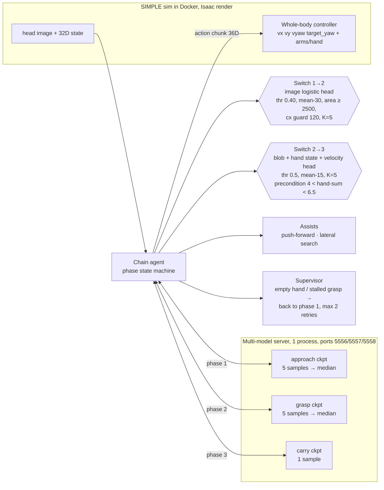

## GR00T N1.7 on SIMPLE — Part 2/2: three-phase chain, results, failures, final architecture

**TL;DR.** The frozen configuration (**chain5**) reaches **14/30 (47 %) official success on VAL with a 2400-step limit** and **7/30 (23 %) within the default 1200 steps**. The three 10-episode samples were 7/10, 6/10 and **1/10**, so the run-to-run variance is huge (95 % CI roughly ±18 points) — please read 47 % as "about half, give or take", not as a stable rate. TEST was not touched.

### 1. Protocol (everything that differs from "the bare model")
- `MAX_STEPS=2400` (task default is 1200; the carry phase alone takes 490–660 steps). The 1200-step number is always reported alongside.
- Median of 5 diffusion samples in phases 1–2; phase 3 uses a single sample.
- Approach assists (push-forward / lateral search) are **not** part of the model.
- Phase switches use trained logistic heads (image, plus right-hand state and velocity for 2→3). The supervisor uses the right-hand joint state. **No simulator pose enters any decision** (only logs).
- Phase 3 held-out episodes are assumed (see Part 1); overlap with SIMPLE episodes can't be verified.

### 2. Results

| step | setup | official success |
|---|---|---|
| `f1_chain3_val3` | 3 VAL episodes, no supervisor | 2/3 |
| `f1_chain4_val10_s0` | 10 VAL episodes, seed 0, no supervisor | 2/10 |
| `f2_sup_sup6` | 6 episodes **used for calibration** (smoke test only) | 5/6 |
| `f2_final_val10_s1` | chain5, 10 VAL, seed 1 | 7/10 (4/10 in 1200 steps) |
| `f2_final_val10_s2` | chain5, 10 VAL, seed 2 | 6/10 (2/10 in 1200) |
| `f2_final_val10_s3` | chain5, 10 VAL, seed 3 | 1/10 (1/10 in 1200) |
| **pooled** | **30 runs** | **14/30 = 47 % (7/30 = 23 % in 1200)** |

Caveats: the server is unseeded, so the same episode can flip between runs; seeds 1–3 overlap in episodes (each draws 10 of the 31 VAL episodes), and some seed-1 episodes were also used for calibration (the strictly new ones scored 4/6). The goal of ≥30 % was **met with free steps (47 %) and not met with the standard limit (23 %)**.

### 3. Where the 16 failures come from (30 chain5 runs)
Switched 1→2 in 24/30.

| failure | count | episodes / what happened |
|---|---|---|
| approach never switched | 6 | VAL 15 ×2, 11 ×2, 25, 21 — tote never in view, search goes to the wrong side, or the centering guard blocks the switch |
| approach too late | 1 | VAL 29, switched at step 1814 |
| grasp failed / tote dropped | 7 | VAL 18 ×2, 5, 9, 2, 4, 20 — hand closes empty, tote often on the floor |
| carry / placement failed | 2 | VAL 17, 7 — reached the table (~0.3 m) but the tote tipped or fell |

The 2→3 precondition ("blocked finger", below) removed a false 2→3 switch seen earlier (VAL 24, seed 0). We did not check false 2→3 switches episode by episode in the final three samples.

### 4. Supervisor (recovery 2→1)
When the hand closes empty or the grasp stalls, the agent goes back to phase 1 (max 2 retries, hold 150 steps with the hand open). **2 of 7 retries ended in success (29 %)**, right at the 30 % target with a very small n. If the tote is already on the floor (blob cy > 230) the run is declared failed. The "empty hand" signal (sum of right-hand |joint| ≥ 6.5 vs 5.3–6.3 when holding the tote) was calibrated on only 4 episodes. We **cannot attribute** the 2/6 → 5/6 jump on `sup6` to the supervisor: the episodes with no recovery event changed outcome from variance alone.

### 5. What did not work
- Image-only "is the tote held?" head: AUC 0.6–0.8 (n=32), too weak. The 2→3 head uses blob + right-hand state + velocity instead (CV AUC 0.984, GroupKFold).
- **H-B1** (relax the centering guard): never fired. **H-B2** (rotation search): v1 did not rotate the robot (the WBC follows an absolute `target_yaw`); v2 (`chain7`, integrates `target_yaw`) barely rotated (±0.1–0.6 rad) and scored 0/4. Both discarded.

### 6. Final architecture (chain5)

Flow: **approach → [image head + assists] → grasp → [blob/hand head with "finger blocked" precondition] → carry**; the supervisor can send grasp back to approach (box on the floor → fail).

Key frozen parameters:

| component | value |
|---|---|
| 1→2 trigger | logistic on blue-blob features; thr 0.40, moving mean 30, min area 2500, cx guard 120, K=5 |
| 2→3 trigger | logistic on blob + right-hand state + velocity (`carry_head_lin.json`); thr 0.5, mean 15, K=5, min grasp 100 steps |
| hand signal | `hq = Σ|right-hand joint state|`; empty if ≥ 6.5 for 10 steps after closing (`hq>4`); stall if ≥ 350 steps without closing or ≥ 700 steps in phase |
| 2→3 precondition | 4 < hq < 6.5 (finger blocked by the tote) |
| retries | max 2, hold 150 steps with hand open (hq < 1) |
| sampling | median of 5 (phases 1–2), 1 sample (phase 3) |
| GPU | all 3 models on CPU RAM, the active one is swapped to GPU on demand (~2.5 s) |

### 7. Limitations
- High variance (1/10 to 7/10), unseeded server, and non-independent episodes across samples; 47 % is not a stable rate.
- Heads and thresholds were calibrated on VAL logs (in-sample); the hand-empty threshold on 4 episodes.
- Switch heads depend on a colour mask tuned for the Isaac render; a real robot would need a proper detector.
- Supervisor effect is not statistically established.

### 8. Next steps (in priority order)
1. **Tote dropped during grasp (7/30)**: investigate why it falls after closing (hand force/position); train grasp with the recovered failures as negatives.
2. **Approach for lateral/hidden totes (6/30)**: a working active search (control `target_yaw` from the start) or approach data with more diverse start poses.
3. **Decide the step budget** (1200 is nearly infeasible for the full task).
4. **Seed the server and run more samples** before comparing versions.

*Code: `scripts/gr00t/` (`serve_chain.py`, `gr00t_chain5_decoupled_wbc.py`, `chain_assist.py`, `docker_eval_chain11.sh`, `train_carry_head.py`, `carry_head_lin.json`). Reports (Portuguese): `docs/wla/FASE1_2_RELATORIO.md`, `docs/wla/FASE0_RELATORIO.md`, `docs/wla/PLANO_3_FASES.md` (per-iteration log).*
